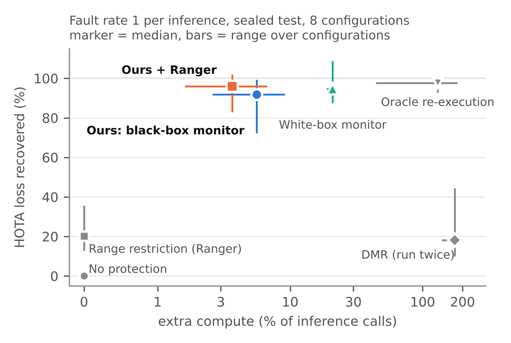

# Physics as a Checksum

Detecting the harm, not the fault, in detection-and-tracking pipelines.

This repository has the code, the results and the paper for a study of hardware faults (single bit flips) in a video perception pipeline: an object detector whose boxes feed a multi-object tracker. Most work on neural network faults stops at the network output. I follow each fault into the tracker and ask two questions: how many corrupted detector outputs actually change the tracks, and how cheaply can the ones that do be caught.

Paper: [paper/physics_as_a_checksum.pdf](paper/physics_as_a_checksum.pdf)

## What I found

All numbers are from a sealed test split (the second half of every sequence), evaluated once after every setting had been frozen on development data. There are eight configurations: five detectors (YOLOv8n/s/m, YOLO11s, RT-DETR-L), two trackers (ByteTrack, SORT) and three datasets (MOT17, MOT20, KITTI).

1. The tracker masks almost everything. Of the faults that change the detector output, 94.6 to 96.3% leave the tracks identical to the fault-free run. Only 0.2 to 2.0% of all injected faults cause a tracking error that outlives the faulty frame.
2. So I monitor consequences instead of faults. The monitor reads only the detector output and the tracker state: Kalman innovations, unpredicted births, unexplained track deaths and frame-to-frame changes, combined with Fisher's method. Its threshold comes from split-conformal calibration on clean frames, so the false alarm rate, and with it the re-execution cost on healthy frames, is fixed in advance. On an alarm the detector runs again.
3. At one fault per inference, the monitor recovers 72 to 99% of the HOTA loss for 2.6 to 9.1% extra inference calls. Running the detector twice (DMR) recovers 10 to 44% for 140 to 187%. A white-box activation-range monitor recovers 88 to 109% but costs 19 to 22%, because it reacts to every out-of-range activation, including the ones the tracker would have absorbed. Range restriction alone recovers 13 to 36%; together with the monitor it reaches 83 to 102% for 1.6 to 6.7%.
4. Persistent weight faults are handled separately. A single integer reduction over all FP16 weights catches every single bit flip for 1.2 to 7.7% of an inference.



What did not work as well:

- The false alarm guarantee assumes the clean frames at test time look like the calibration frames. On MOT20 the crowd changes within each sequence, and the fixed threshold gave 3.65% false alarms at a nominal 1%. An adaptive threshold fixes the rate but lowers detection on MOT20 from 91.5% to 72.6%.
- On RT-DETR the monitor detects only 69% of the faults that propagate. Many of the misses add a duplicate of a real object with an ordinary-looking score, which clean frames also produce. On KITTI recovery is the lowest, 72%.
- On development data, NMS in front of the tracker looked like it made RT-DETR's duplicate-box faults harmless. On the sealed test it did not. It only improved clean accuracy by removing duplicates. I report that result as it came out.

## Layout

```
step0_env.py ... step10b_range.py   the pipeline, one script per step (each file starts with a description)
run.py                              runs the steps for one configuration
run_grid.py                         runs every configuration (resumable)
collect_reports.py                  gathers all reports into all_reports.txt
common.py                           configurations, datasets, time splits
detector.py                         detector wrapper with fault injection through forward hooks
faults.py                           fault sampling and outcome classification
monitors.py                         frame statistics and calibrated scores
trackers/bytetrack.py               ByteTrack / SORT re-implementation
third_party/trackeval/              TrackEval (MIT) for HOTA
tests/run_selftest.py               end-to-end self-test with a synthetic detector (no GPU, no data)
paper/                              LaTeX source, figures, tables, and the scripts that build them
reported_results/all_reports.txt    every report behind the paper, all eight configurations
```

The steps:

| step | script | what it does |
|---|---|---|
| 0 | step0_env.py | checks bit flips, hooks, determinism and weight restore |
| 1 | step1_golden.py | fault-free runs and clean statistics |
| 2 | step2_campaign.py | fault campaigns (6000 activation and 1500 weight faults on development data) |
| 3 | step3_analyze.py | masking, monitors and range restriction on development data |
| 4 | step4_e2e.py | end-to-end protection on development data |
| 5 | step5_calibration.py | split-conformal false alarm control |
| 6 | step6_adaptive.py | adaptive conformal threshold with re-execution feedback |
| 7 | step7_weights.py | weight checksum: timing and replay |
| 8 | step8_sanitize.py | NMS sanitizer (development) |
| - | diag_escapes.py | what the monitors miss (development) |
| 9 | step9_sealed.py | sealed test: frozen protocol, campaign, end-to-end |
| 10 | step10_baselines.py | range restriction, white-box monitor, all-bit model on the sealed test |
| 11 | step10b_range.py | white-box monitor with the same calibration as ours, sealed test |

## Reproducing

I ran everything on one laptop (Windows, RTX 3070 Ti). The full grid takes several days of GPU time.

1. Install torch and torchvision for your GPU, then `pip install -r requirements.txt`. The detector weights download on first use.
2. Get the training sets (ground truth is needed): MOT17 and MOT20 from motchallenge.net, KITTI tracking from cvlibs.net. Point the code at them with `MOT17_ROOT`, `MOT20_ROOT` and `KITTI_ROOT`, or pass `--mot17 <path>` to any step. KITTI is expected as `training/image_02/0000/000000.png` and `training/label_02/0000.txt`.
3. Check the code without a GPU or data:
   ```
   python tests/run_selftest.py
   ```
4. Development steps for all configurations, then the development-only analyses:
   ```
   python run_grid.py
   python step8_sanitize.py --all
   python diag_escapes.py --all
   ```
5. The sealed test and the baselines. Step 9 writes the protocol file before it touches the test split and refuses to run if it changes:
   ```
   python run_grid.py --steps 9 10 11
   python collect_reports.py
   ```
6. Tables and figures:
   ```
   cd paper
   python extract.py ../all_reports.txt
   python make_figures.py
   ```

Every step skips work that is already done, so any command can be stopped and started again.

## Citation

```
@misc{yang2026physicschecksum,
  title  = {Physics as a Checksum: Detecting the Harm, Not the Fault, in Detection-and-Tracking Pipelines},
  author = {Yang, Jinhao},
  year   = {2026},
  note   = {https://github.com/EnokiSachi/physics-as-a-checksum}
}
```

## License

AGPL-3.0, because the detectors come from Ultralytics, which is AGPL-3.0. `third_party/trackeval` keeps its MIT license.

## Development note

Faults are emulated in software: forward hooks flip one bit of one FP16 element in a layer output, or one bit of one weight. This is not hardware fault injection, and the timings come from one laptop GPU with Python hooks in the loop, so they show relative cost rather than what an embedded accelerator would see. Extra compute is counted in inference calls. Every policy in an end-to-end run sees the same fault sequence, because the fault drawn for a call depends only on the seed, rate, sequence, frame and attempt.
